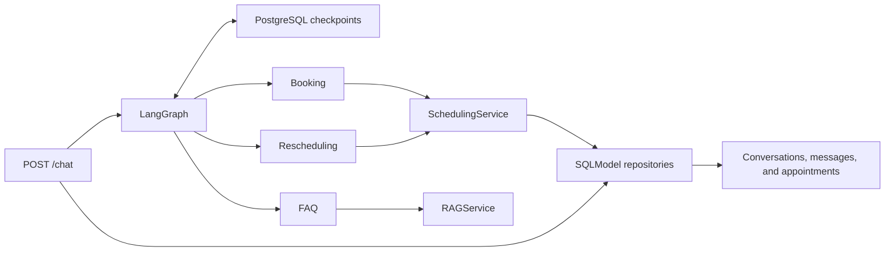

# Nova Wellness & Aesthetics - AI Concierge System

Welcome to the backend engine of Nova Desk, a luxury medical spa AI assistant. Powered by FastAPI and LangGraph, this backend orchestrates intent classification, dynamic scheduling, multi-turn booking/rescheduling, and conversational FAQ retrievals with enterprise-grade guardrails.
## 1. Backend Agent Engine (`back-end/`)

Powered by **FastAPI** and **LangGraph**, the backend hosts the conversational state machine, memory persistence, fuzzy matching systems, and DB-connected scheduling tools.

* **Vercel Deployed URL:** [https://nova-desk-ai-agent.vercel.app](https://nova-desk-ai-agent.vercel.app)

## Scheduling and FAQ workflows

1. `POST /chat` resolves the conversation, closes its database session, and invokes LangGraph with the new user message. The conversation ID is the checkpoint thread ID. The route writes the user and assistant messages together after the graph returns. [Chat route](back-end/app/api/routes/chat.py)
2. The classifier routes the turn. Booking collects a treatment, date, time, name, and email. Rescheduling looks up upcoming appointments by email and validates the selected appointment ID against those results. The extraction prompts include calendar dates and the last offered times. The scheduling service matches the requested treatment against the catalog. [Graph](back-end/app/agent/graph.py) · [Booking](back-end/app/agent/booking.py) · [Rescheduling](back-end/app/agent/rescheduling.py)
3. A complete draft receives a preview. A standalone yes or no answers a pending summary directly. A reply that also changes the time or treatment goes through extraction and receives a revised preview. A confirmed write rechecks availability inside the transaction. Reschedules exclude only the selected appointment when checking occupied slots. If a slot is lost, the dialogue builds the guest's reply and the next turn's offered times from the same availability read. [Scheduling service](back-end/app/services/scheduling_service.py) · [Scheduling dialogue](back-end/app/agent/scheduling_dialogue.py)
4. FAQ turns retrieve reference material through the RAG service. During a booking, the graph adds an invitation to resume after obtaining the reusable FAQ answer. The HTTP response exposes the current drafts and per-turn operation names to the inspector. [FAQ node](back-end/app/agent/nodes.py) · [RAG service](back-end/app/services/rag_service.py)

## 🛠️ Technology Stack (Backend)

| Component | Technology | Description / Usage |
| :--- | :--- | :--- |
| **API Core** | [FastAPI](https://fastapi.tiangolo.com/) | High-performance, asynchronous REST API router |
| **State Machine** | [LangGraph](https://langchain-ai.github.io/langgraph/) | Handles conversation state, routing conditional edges, and loops |
| **LLM Interface** | [LangChain Core](https://github.com/langchain-ai/langchain) | Structured model output and prompt templating |
| **Database ORM** | [SQLModel](https://sqlmodel.tiangolo.com/) | Modern Python SQL database wrapper combining SQLAlchemy & Pydantic |
| **Fuzzy Matching** | `difflib` (Python Standard Lib) | Sequence matching for spa treatment validation |
| **Timezone Management** | `zoneinfo` | Standardized scheduling using local zone `Asia/Karachi` |

---

## 🌐 Hosting & Services (Backend)

* **State & Transactional DB (PostgreSQL)**: Hosted serverless on [Neon Tech](https://neon.tech/) (AWS `us-east-2`), utilizing connection poolers for high scalability.
* **Vector Database (RAG)**: Hosted on [Pinecone Serverless](https://www.pinecone.io/) using `cosine` similarity to store and query highly optimized embeddings.
* **Large Language Models (LLMs)**:
  * **Groq API**: High-speed GPT-OSS models (`openai/gpt-oss-120b`, `openai/gpt-oss-20b`) for primary intent classification, high-accuracy tool calling, and text generation.
  * **Google Gemini API**: Utilizing `text-embedding-004` to generate 768-dimensional document vectors, alongside large-context models for complex date-math parsing.
* **Application API**: Deployed live on Render.

---

## Backend architecture



- **Graph and state.** `app/agent/graph.py` registers stable node names and supplies one scheduler per graph. `state.py` defines the checkpoint fields. `chat_model.py` binds extraction schemas and model fallbacks. `prompts.py` assembles the calendar and conversation context.
- **Conversation logic.** `booking.py` and `rescheduling.py` own their drafts and route each turn. `scheduling_dialogue.py` handles shared date/time changes, confirmation, slot offers, and recovery. `nodes.py` contains the classifier, FAQ, and out-of-scope handlers.
- **Scheduling and storage.** `app/services/scheduling_service.py` opens a session for each database operation. The repositories perform catalog, user, conversation, and appointment queries. PostgreSQL advisory locks and a unique index protect scheduled start times. The slot grid and booking horizon are defined in `app/utils/date_utils.py` and application settings.
- **FAQ ingestion.** The admin-protected upload route calls `app/services/rag_service.py` to ingest PDF content. FAQ answers and retrieval contexts are cached separately from booking state.

## ⚙️ Running Locally (Backend)

1. **Install Dependencies**:
   ```bash
   pip install -r requirements.txt
   ```
2. **Setup Environment**:
   Make sure you copy and configure `.env` with the necessary keys (Neon PostgreSQL link, Groq/Gemini Keys, Pinecone API settings).
3. **Start the API Server**:
   ```bash
   uvicorn app.main:app --reload
   ```
   The backend API docs will be available at `http://localhost:8000/docs`.

---
---

## 2.  Frontend Dashboard (`front-end/`)

A luxury, clean visual interface for clients to chat with **Nova** and developers to inspect the state machine in real-time. Deployed on [Vercel](https://nova-desk-ai-agent.vercel.app).

## 🚀 Key Features

* **Real-time Dev Mode (State Inspector)**: A side-by-side debugging panel displaying the current conversation state, extracted entity variables, parsed intent, and executing tools on every message.
* **Latency Counter**: Displays response latency in milliseconds to monitor system and API performance.
* **Rich Markdown Support**: Fully parses Markdown text responses (including treatment lists, bold summaries, and line formatting) using `react-markdown`.
* **State Reset capability**: Single-click session wipe (`Reset Session`) to start fresh and reset checkpointer memory.
* **Interactive UI**: Elegant luxury spa design language, featuring smooth transitions, rounded cards, and dev tools toggle switches.

---

## 🛠️ Technology Stack (Frontend)

| Component | Technology | Description / Usage |
| :--- | :--- | :--- |
| **Framework** | [React 19](https://react.dev/) | Virtual DOM library for responsive UI layout |
| **Build Tool** | [Vite 8](https://vite.dev/) | Ultra-fast bundling, Hot Module Replacement (HMR), and server runner |
| **Markdown Parser**| [react-markdown](https://github.com/remarkjs/react-markdown) | Secure, native React component to render rich chat formats |
| **Oxlint** | [Oxlint](https://oxc.rs/docs/guide/usage/linter.html) | High performance JavaScript/JSX compiler and code-quality validator |
| **CSS styling** | Vanilla CSS | Fully customized tokens representing luxury spa styles, gradients, and custom components |

---

## 🌐 Hosting & Services (Frontend)

* **UI Hosting Platform**: Hosted on **Vercel** (`https://nova-desk-ai-agent.vercel.app`) with automatic deployment pipelines linked to GitHub.
* **API Integration**: Connects to the Render backend via `VITE_API_URL` configuration inside build-time environment variables.

---

## 📂 Project Structure (Frontend)

```bash
front-end/
├── public/                # Static public assets (icons, images)
├── src/
│   ├── assets/            # App branding (logos, graphics)
│   ├── components/        # Isolated UI sections:
│   │   ├── ChatPanel.jsx       # Chat window UI and message rendering
│   │   ├── InspectorPanel.jsx  # Live state tree visualizer for developers
│   │   └── JsonTree.jsx        # Recursive JSON structure viewer
│   ├── App.jsx            # Main app shell, local state manager, and API calls
│   ├── index.css          # Visual styles, color palettes, animations, and layouts
│   └── main.jsx           # Vite React mounting file
├── index.html             # Basic HTML entry point
├── package.json           # Scripts, metadata, and packages
└── vite.config.js         # Vite configuration with React compiler plugin
```

---

## ⚙️ Running Locally (Frontend)

1. **Install Dependencies**:
   ```bash
   npm install
   ```
2. **Setup Environment**:
   Create a `.env.local` file and add the local backend API server path:
   ```env
   VITE_API_URL=http://localhost:8080
   ```
3. **Start Dev Server**:
   ```bash
   npm run dev
   ```
   Open `http://localhost:5173` in your browser.
