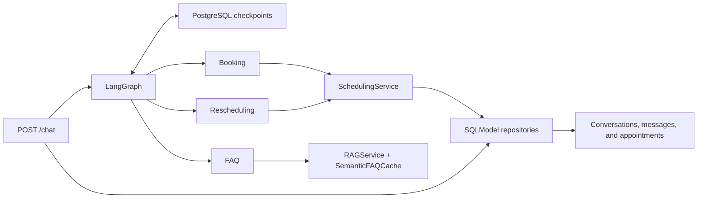

# Nova Wellness & Aesthetics - AI Concierge System

Welcome to the repository for **Nova Desk**, a luxury medical spa AI concierge system. Powered by **FastAPI**, **LangGraph**, **PostgreSQL**, and **Pinecone**, it orchestrates intent classification, calendar-grounded multi-turn booking and rescheduling, ACID-safe slot locking, multi-tier semantic FAQ caching, and a DeepEval RAG evaluation pipeline.

* **Vercel Deployed URL:** [https://nova-desk-ai-agent.vercel.app](https://nova-desk-ai-agent.vercel.app)

---

## 1. Backend Agent Engine (`back-end/`)

The backend hosts the LangGraph state machine, repository and application service layers, transactional PostgreSQL persistence, Pinecone RAG retrieval, and multi-provider LLM routing.

### Scheduling and FAQ Workflows

1. `POST /chat` resolves or creates the conversation in a short-lived DB session (~2ms), releases the pooled connection before invoking LangGraph, and uses `conversation_id` as the checkpoint `thread_id`. User and assistant messages are persisted atomically after the workflow returns. [Chat route](back-end/app/api/routes/chat.py)
2. `classify_intent` routes each turn across FAQ retrieval, booking, rescheduling, or an out-of-scope guardrail. Booking (`collect_appointment_details`) collects service, date, time, name, and email using calendar-grounded date rules (`utils/date_utils.py`). Rescheduling (`collect_reschedule_details`) looks up upcoming appointments deterministically via `SchedulingService.get_appointments_by_email()`, validates the selected `appointment_id`, and supports date, time, or treatment changes without redundant LLM tool-calling loops. [Graph](back-end/app/agent/graph.py) · [Booking](back-end/app/agent/booking.py) · [Rescheduling](back-end/app/agent/rescheduling.py)
3. Complete drafts present a preview summary (`ask_booking_clarification` / `ask_reschedule_clarification`) re-verified against live availability and catalog matching. A standalone `"yes"` commits the change through `SchedulingService`, while edits to date, time, or treatment update the draft and issue a revised preview. Reschedules exclude the guest's own `appointment_id` when checking occupied slots, and slot conflicts return structured remaining options to keep `offered_times` synchronized in state. [Scheduling service](back-end/app/services/scheduling_service.py) · [Scheduling dialogue](back-end/app/agent/scheduling_dialogue.py)
4. FAQ turns retrieve context via `RAGService.answer_faq()`. During an active booking, `handle_retreive_faqs` appends a booking resumption prompt outside the shared FAQ cache so cached base answers remain reusable across guests. Protected PDF ingestion (`POST /upload-faqs`) requires `X-Admin-API-Key`, deduplicates chunks via deterministic SHA-256 IDs, and invalidates the FAQ cache upon completion. [FAQ node](back-end/app/agent/nodes.py) · [RAG service](back-end/app/services/rag_service.py) · [Upload route](back-end/app/api/routes/knowledge_base.py)

---

### Core Engineering & Production Safeguards

#### ACID Transactions & Concurrency Locking
Appointment writes in [`SchedulingService`](back-end/app/services/scheduling_service.py) and [`AppointmentRepository`](back-end/app/repositories/appointment_repo.py) protect against race conditions and double-booking through three coordinated database layers:
* **Pessimistic Row Locking (`SELECT ... FOR UPDATE`):** [`get_by_id_for_update()`](back-end/app/repositories/appointment_repo.py#L45) locks an existing appointment row before re-validating slot availability or applying a reschedule/treatment change.
* **Transaction-Scoped PostgreSQL Advisory Locks:** [`acquire_slot_advisory_lock()`](back-end/app/repositories/appointment_repo.py#L22) acquires `pg_advisory_xact_lock(hashtext('slot:YYYY-MM-DD:HH:MM'))` so concurrent booking attempts for an unoccupied slot serialize cleanly and release automatically on commit or rollback.
* **Engine-Level Partial Unique Index & Constraint Classification:** [`Appointment`](back-end/app/models/domain.py#L88) defines the partial unique index `ix_unique_scheduled_slot` on `(appointment_date, appointment_time) WHERE status = 'scheduled'` (alongside `ck_appointment_valid_status`), guaranteeing double-booking impossibility at the DB engine level while retaining cancelled/historical rows. All writes run inside [`atomic_transaction()`](back-end/app/core/database.py#L57), and [`_is_slot_conflict()`](back-end/app/services/scheduling_service.py#L48) specifically inspects `ix_unique_scheduled_slot` violations to surface fresh remaining slot alternatives cleanly.
* **Non-Blocking Pool Hygiene:** Synchronous `def` route handlers dispatch blocking I/O to Starlette's worker threadpool while releasing SQLAlchemy connections prior to LLM/RAG network calls; LangGraph's `ConnectionPool` is initialized and bounded (`DB_POOL_SIZE`) inside FastAPI's [`lifespan`](back-end/app/main.py#L22) rather than at import time.

#### Two-Tier Caching & Semantic FAQ Cache
Implemented in [`app/core/cache.py`](back-end/app/core/cache.py) and wired into [`ServiceRepository`](back-end/app/repositories/service_repo.py) and [`RAGService`](back-end/app/services/rag_service.py):
* **Tier-1 Catalog & Embedding TTL Caches (`TTLCache`):** Thread-safe bounded LRU + TTL caches (`service_catalog_cache`, 15-min TTL; query embedding cache, 24h TTL). `ServiceRepository.list_all()` snapshots detached `Service` instances so multi-turn extraction and preview reads avoid redundant catalog SQL queries.
* **Tier-2 Two-Stage Semantic FAQ Cache (`SemanticFAQCache`, 24h TTL, max 500 entries):**
  * *Stage 1 (Exact Normalized Match):* Normalizes whitespace, casing, and punctuation via `normalize_query_text()` for an O(1) cache hit at **zero API cost** (bypassing embeddings, Pinecone, and LLM synthesis).
  * *Stage 2 (Cosine Similarity Match):* Computes a normalized unit embedding once (`get_or_compute_unit_vector`) and evaluates cosine similarity (`np.dot`) against cached FAQ vectors. Paraphrased queries exceeding `SEMANTIC_CACHE_THRESHOLD` (`0.92`) return the cached answer and `raw_contexts` immediately without hitting Pinecone or an LLM.
  * *Automatic Cache Invalidation:* Re-uploading updated FAQ PDFs via `POST /upload-faqs` triggers `SemanticFAQCache.clear()` inside `RAGService.ingest_pdf()`.

#### Multi-Bucket LLM Registry & Fail-Fast Failover
Implemented in [`LLMRegistry`](back-end/app/agent/chat_model.py) and configured via [`Settings`](back-end/app/core/config.py):
* **Quota-Bucket Isolation:** Each LLM-backed role (`intent_classification`, `collect_appointment_details`, `collect_reschedule_details`, `handle_retreive_faqs`) routes across separate per-model and cross-provider rate-limit buckets rather than funneling all turns into one shared ceiling.
* **Fail-Fast Configuration:** All model clients use `LLM_MAX_RETRIES = 0` and `LLM_TIMEOUT_SECONDS = 15.0` so HTTP `429` or `503` errors fail over immediately to the next provider bucket without blocking on SDK retry loops.
* **Pre-Bound Structured Fallbacks:** `LLMRegistry.get_structured_llm()` binds `.with_structured_output(Schema)` onto each candidate (`ChatGroq`, `ChatGoogleGenerativeAI`, `ChatOpenAI`) individually before chaining `.with_fallbacks(...)`, paired with [`invoke_structured()`](back-end/app/agent/chat_model.py#L137) to guard against malformed JSON / `None` outputs.

---

### 🛠️ Technology Stack (Backend)

| Component | Technology | Description / Usage |
| :--- | :--- | :--- |
| **API Core** | [FastAPI](https://fastapi.tiangolo.com/) | Threadpool-dispatched sync REST endpoints (`/chat`, `/upload-faqs`) with centralized domain exception handlers |
| **State Machine** | [LangGraph](https://langchain-ai.github.io/langgraph/) | Persistent multi-turn conversation graph backed by `PostgresSaver` checkpoints |
| **LLM Interface** | [LangChain Core](https://github.com/langchain-ai/langchain) | Multi-provider structured output, prompt templating, and fallback chains |
| **Database ORM** | [SQLModel](https://sqlmodel.tiangolo.com/) | Repository pattern over SQLAlchemy & Pydantic with PostgreSQL advisory/row locks |
| **RAG & Ingestion** | [PyMuPDF](https://pymupdf.readthedocs.io/) / [Pinecone](https://www.pinecone.io/) | PDF chunking (`1000` chars / `200` overlap), deterministic SHA-256 chunk deduplication, vector search |
| **RAG Evaluation** | [DeepEval](https://docs.confident-ai.com/) | Automated IR (`Precision@K`, `Recall@K`, `MRR@K`) and LLM-as-a-Judge (`Faithfulness`, `Answer Relevancy`) suite |
| **Fuzzy Matching** | `difflib` (Python Standard Lib) | Catalog treatment matching with configurable similarity cutoff (`FUZZY_MATCH_CUTOFF`) |
| **Timezone Management** | `zoneinfo` | Business-hours slot grid and date validation standardized to `SPA_TIMEZONE` (`Asia/Karachi`) |

---

### 🌐 Hosting & Services (Backend)

* **State & Transactional DB (PostgreSQL):** Hosted serverless on [Neon Tech](https://neon.tech/) (AWS `us-east-2`), utilizing pooled connections and PostgreSQL advisory locks / partial unique indexes.
* **Vector Database (RAG):** Hosted on [Pinecone Serverless](https://www.pinecone.io/) (`nova-spa-faqs`) using `cosine` similarity with deterministic chunk IDs for idempotent re-ingestion.
* **Large Language Models & Embeddings:**
  * **Groq API:** `openai/gpt-oss-20b` (primary for intent classification and FAQ synthesis) and `qwen/qwen3.8-27b` (Tier-2 structured extraction fallback).
  * **Google Gemini API:** `gemini-3.5-flash-lite` and `gemini-3.1-flash-lite` (structured booking/reschedule extraction and cross-provider fallbacks), plus `models/gemini-embedding-001` (`768`-dimensional embeddings).
  * **OpenRouter (Optional):** Free-tier fallback models (`nvidia/nemotron-3.5-lightning:free`, `openrouter/free`) when `OPENROUTER_API_KEY` is set.
* **Application API:** Deployed on Render.

---

### Backend Architecture



* **Graph & State:** `app/agent/graph.py` registers stable node names via `build_workflow()` and injects a `SchedulingService` backed by `create_session`. `state.py` defines checkpointed `AgentState`, `BookingState`, and `RescheduleState` dictionaries. `chat_model.py` manages `LLMRegistry` multi-bucket fallbacks, and `prompts.py` assembles extraction and FAQ instructions.
* **Conversation Flows:** `booking.py` and `rescheduling.py` manage extraction, routing, and service calls, while `scheduling_dialogue.py` unifies date/time validation, confirmation state transitions, slot rendering, and conflict recovery. `nodes.py` handles intent classification, FAQ synthesis, and out-of-scope guardrails.
* **Scheduling & Storage:** `SchedulingService` acquires short-lived sessions per read preview or atomic write transaction, backed by SQLModel repositories (`user_repo.py`, `service_repo.py`, `appointment_repo.py`, `conversation_repo.py`).
* **FAQ Ingestion & Retrieval:** `POST /upload-faqs` enforces `X-Admin-API-Key` authentication via `verify_admin_api_key` and delegates to `RAGService.ingest_pdf()`, which parses PDFs, computes deterministic chunk IDs, upserts to Pinecone, and invalidates `SemanticFAQCache`.

---

### 📊 RAG Evaluation Suite (`DeepEval`)

To systematically measure retrieval quality and answer grounding in isolation from the semantic cache, an end-to-end RAG evaluation pipeline was built under [`back-end/evals/rag/`](back-end/evals/rag/):

#### Dataset & Methodology
* **Golden Dataset ([`goldens.jsonl`](back-end/evals/rag/data/goldens.jsonl)):** **30 curated test cases** built from the clinic's FAQ knowledge base, split into **`development` (20)** and **`holdout` (10)** subsets across four query categories:
  * **`direct` (10):** Single-fact lookups (hours, pricing, duration, downtime, policies).
  * **`paraphrase` (8):** Colloquial / indirect guest phrasing requiring semantic matching.
  * **`multi` (6):** Multi-chunk synthesis questions requiring evidence across separate pages (e.g., HydraFacial age policy on p. 8 + pricing on p. 3).
  * **`unanswerable` (6):** In-domain queries missing from the FAQ PDF to test abstention & specialist handoff guardrails.
* **Two-Stage Evaluation Pipeline:**
  1. **Prediction Pass ([`generate_predictions.py`](back-end/evals/rag/generate_predictions.py)):** Calls `RAGService.retrieve(..., top_k=3)` directly using `models/gemini-embedding-001` against the hosted Pinecone index `nova-spa-faqs`, generates answers using **`gemini-3.5-flash-lite`** under `FAQ_SYSTEM_PROMPT`, and writes incremental JSONL checkpoints to [`predictions.jsonl`](back-end/evals/rag/data/predictions.jsonl).
  2. **Scoring Pass ([`metrics.py`](back-end/evals/rag/metrics.py), [`run_evals.py`](back-end/evals/rag/run_evals.py)):** Evaluates each `LLMTestCase` across 5 metrics and writes the full aggregated report to [`eval_results.json`](back-end/evals/rag/data/eval_results.json):
     * *Deterministic IR Metrics:* `Precision@3`, `Recall@3`, and `MRR@3` verified against ground-truth `evidence` chunk IDs and normalized quotes.
     * *LLM-as-a-Judge Metrics (Threshold `0.80`):* DeepEval `FaithfulnessMetric` and `AnswerRelevancyMetric` powered by **`gemini-3.1-flash-lite`** wrapped in `RateLimitedGeminiJudge` (~12.5 RPM pacing + transient backoff).

#### Baseline Findings & Prompt Iteration (`Before vs. After FAQ_SYSTEM_PROMPT Tuning`)

In the baseline run, vector retrieval (`Recall@3 = 1.00`, `MRR@3 = 1.00`) and factual grounding (`Faithfulness = 1.00`) were already at 100%, **but `Answer Relevancy` scored `0.4838` (`13.3%` pass rate, 4/30)**. Statement-level attribution from DeepEval pinpointed three prompt defects in `FAQ_SYSTEM_PROMPT`:
1. Instructing the model to format *"durations, pricing, and prep instructions"* caused it to dump unsolicited treatment cards even when only one attribute (e.g., downtime or prep) was requested.
2. Conversational opening/closing filler diluted short 1-fact replies across multiple extracted statements.
3. A static generic fallback (`"Hmm... let me connect you..."`) omitted the user's requested topic on `unanswerable` queries (`0.00` Answer Relevancy on 4/6 unanswerable cases).

Tweaking `FAQ_SYSTEM_PROMPT` ([`prompts.py#L38-L48`](back-end/app/agent/prompts.py#L38-L48)) to enforce **question-scoped precision**, **zero greeting/closing filler**, and **topic-aware abstention** produced the following verified improvement:

| Metric (`Top-K = 3`) | Baseline (All 30) | After Prompt Fix (All 30) | Baseline (24 Answerable) | After Prompt Fix (24 Answerable) | Notes |
| :--- | :---: | :---: | :---: | :---: | :--- |
| **Precision@3** | 0.5333 (100%) | **0.5333 (100%)** | 0.4166 (100%) | **0.4166 (100%)** | Matches theoretical ceiling (`30` evidence / `72` slots = `0.4167`; Norm P@3 = `1.00`) |
| **Recall@3** | 1.0000 (100%) | **1.0000 (100%)** | 1.0000 (100%) | **1.0000 (100%)** | `30/30` required evidence chunks retrieved across all `direct`, `paraphrase`, and `multi` queries |
| **MRR@3** | 1.0000 (100%) | **1.0000 (100%)** | 1.0000 (100%) | **1.0000 (100%)** | First relevant evidence chunk ranked `#1` on every answerable query |
| **Faithfulness** | 1.0000 (30/30) | **0.9667 (29/30)** | 1.0000 (24/24) | **0.9583 (23/24)** | Post-fix miss on `faq-14` was a transient Google `504 DEADLINE_EXCEEDED` API error (0 hallucinations observed) |
| **Answer Relevancy** | **0.4838 (13.3%)** | **0.9583 (93.3%)** | **0.5215 (8.3%)** | **0.9896 (95.8%)** | **+0.4745 (+80.0 pts)** overall; post-fix miss on `faq-30` hit Free Tier `500/500 RPD` cap on `gemini-3.1-flash-lite`, and `faq-24` scored `0.75` for citing provider credentials |

**Category Breakdown (`After Prompt Fix`):**
* **`direct` (n=10):** `Precision@3: 0.33` | `Recall@3: 1.00` | `MRR@3: 1.00` | `Faithfulness: 1.00` | `Answer Relevancy: 1.00` *(up from `0.47`)*
* **`paraphrase` (n=8):** `Precision@3: 0.38` | `Recall@3: 1.00` | `MRR@3: 1.00` | `Faithfulness: 0.88`\* | `Answer Relevancy: 1.00` *(up from `0.55`)*
* **`multi` (n=6):** `Precision@3: 0.61` | `Recall@3: 1.00` | `MRR@3: 1.00` | `Faithfulness: 1.00` | `Answer Relevancy: 0.96` *(up from `0.57`)*
* **`unanswerable` (n=6):** `Precision@3: 1.00` | `Recall@3: 1.00` | `MRR@3: 1.00` | `Faithfulness: 1.00` | `Answer Relevancy: 0.83`\*\* *(up from `0.33`)*


---

### ⚙️ Running Locally (Backend)

1. **Install Dependencies** (Python 3.12+ recommended):
   ```bash
   cd back-end
   python -m venv venv
   source venv/bin/activate
   pip install -r requirements.txt
   ```
2. **Setup Environment (`back-end/.env`):**
   Copy [`back-end/.env.example`](back-end/.env.example) to `back-end/.env` and configure `DATABASE_URL`, `GROQ_API_KEY`, `GOOGLE_GEMINI_API_KEY`, `PINECONE_API_KEY`, and optionally `ADMIN_API_KEY` (to enable `POST /upload-faqs`) and `OPENROUTER_API_KEY` (for Tier-3 free fallbacks).
3. **Start the API Server:**
   ```bash
   uvicorn app.main:app --port 8080 --reload
   ```
   Interactive API docs are available at `http://localhost:8080/docs`.
4. **Deploying on Render:**
   * **Root Directory:** `back-end` | **Python Version:** `PYTHON_VERSION=3.12.11`
   * **Build Command:** `pip install -r requirements.txt`
   * **Start Command:** `uvicorn app.main:app --host 0.0.0.0 --port $PORT`
5. **Run the DeepEval RAG Suite (Optional, Separate Env Recommended):**
   ```bash
   pip install -r evals/rag/requirements-eval.txt
   python evals/rag/run_evals.py --force
   ```

---
---

## 2. Frontend Dashboard (`front-end/`)

A luxury, clean visual interface for clients to chat with **Nova** and developers to inspect the state machine in real-time. Deployed on [Vercel](https://nova-desk-ai-agent.vercel.app).

### 🚀 Key Features

* **Real-time Dev Mode (State Inspector):** A side-by-side debugging panel displaying the current conversation state, extracted entity variables, parsed intent, and executed service operations on every turn.
* **Latency Counter:** Displays response latency in milliseconds to monitor system and API performance.
* **Rich Markdown Support:** Parses Markdown text responses cleanly using `react-markdown`.
* **State Reset Capability:** Single-click session wipe (`Reset Session`) to start a fresh thread.
* **Interactive UI:** Luxury spa design language featuring smooth transitions, rounded cards, and a Dev Mode toggle switch.

### 🛠️ Technology Stack (Frontend)

| Component | Technology | Description / Usage |
| :--- | :--- | :--- |
| **Framework** | [React 19](https://react.dev/) | Virtual DOM library for responsive UI layout |
| **Build Tool** | [Vite 8](https://vite.dev/) | Fast bundling, Hot Module Replacement (HMR), and dev server |
| **Markdown Parser** | [react-markdown](https://github.com/remarkjs/react-markdown) | Native React component to render rich formatted replies |
| **Linter** | [Oxlint](https://oxc.rs/docs/guide/usage/linter.html) | High-performance JavaScript/JSX linter |
| **CSS Styling** | Vanilla CSS | Custom tokens representing luxury spa styles and responsive layouts |

### 🌐 Hosting & Services (Frontend)

* **UI Hosting Platform:** Hosted on **Vercel** (`https://nova-desk-ai-agent.vercel.app`) with automatic deployments linked to GitHub.
* **API Integration:** Connects to the backend via `VITE_API_URL` (defaulting to `http://localhost:8080` locally).

### 📂 Project Structure (Frontend)

```bash
front-end/
├── public/                # Static public assets (icons, images)
├── src/
│   ├── assets/            # App branding (logos, graphics)
│   ├── components/        # Isolated UI sections:
│   │   ├── ChatPanel.jsx       # Chat window UI and message rendering
│   │   ├── InspectorPanel.jsx  # Live state tree visualizer for developers
│   │   └── JsonTree.jsx        # Recursive JSON structure viewer
│   ├── App.jsx            # Main app shell, local state manager, and API calls
│   ├── index.css          # Visual styles, color palettes, animations, and layouts
│   └── main.jsx           # Vite React mounting file
├── index.html             # Basic HTML entry point
├── package.json           # Scripts, metadata, and packages
└── vite.config.js         # Vite configuration with React compiler plugin
```

### ⚙️ Running Locally (Frontend)

1. **Install Dependencies:**
   ```bash
   cd front-end
   npm install
   ```
2. **Setup Environment:**
   Create a `.env.local` file and set the backend API URL:
   ```env
   VITE_API_URL=http://localhost:8080
   ```
3. **Start Dev Server:**
   ```bash
   npm run dev
   ```
   Open `http://localhost:5173` in your browser.
